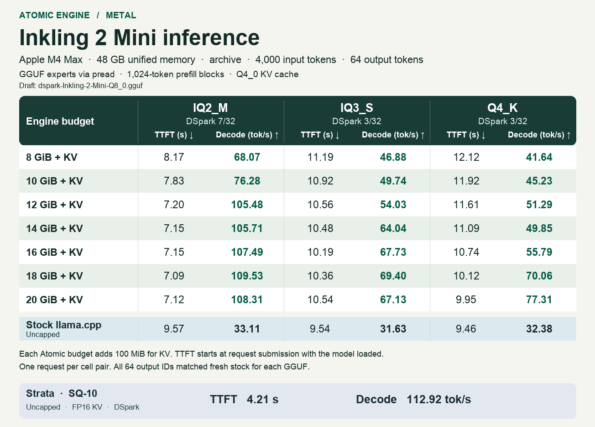
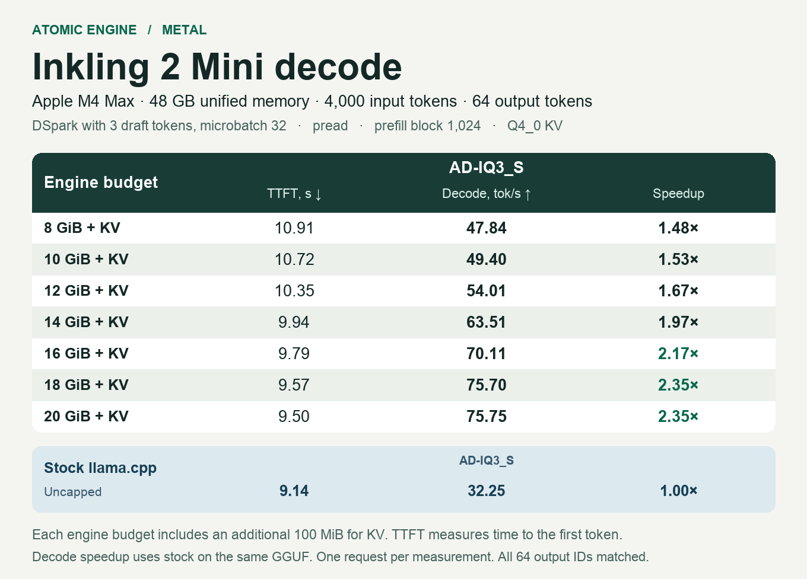

# Atomic Engine

**Developer Preview**

Local AI should leave room for the rest of your work. Atomic Engine builds on
llama.cpp to run a model within a memory budget you set. Model weights, session
state, and compute buffers share that budget. The engine streams expert weights
from the original GGUF as needed. On supported configurations, lowering the budget
frees cached weights while keeping the session alive. On Apple Silicon, Inkling 2
Mini runs through the same core layers several times, so Atomic Engine prioritizes
keeping their expert weights in memory.

## Run Inkling 2 Mini on Apple Silicon

Run Inkling locally on a Mac with Metal. The standard
profile uses the IQ2_M model and a small DSpark draft model. DSpark proposes
tokens and Inkling checks them. With a 14 GiB budget plus 100 MiB for the
attention cache, this pair generated **105.71 tokens/s** on a 48 GB M4 Max
in the archive benchmark below.

### 1. Build Atomic Engine

You need the Xcode command line tools, CMake and the Hugging Face CLI (`hf`).
From a fresh checkout:

```sh
git clone --branch engine-development https://github.com/AtomicBot-ai/atomic-engine.git
cd atomic-engine
cmake -S . -B build-metal \
  -DCMAKE_BUILD_TYPE=Release -DBUILD_SHARED_LIBS=OFF \
  -DLLAMA_BUILD_TESTS=OFF -DLLAMA_BUILD_TOOLS=ON \
  -DLLAMA_BUILD_EXAMPLES=OFF -DLLAMA_BUILD_SERVER=ON -DLLAMA_BUILD_APP=OFF \
  -DLLAMA_BUILD_UI=OFF -DLLAMA_OPENSSL=OFF \
  -DGGML_METAL=ON -DGGML_METAL_EMBED_LIBRARY=ON -DGGML_BLAS=OFF -DGGML_CCACHE=OFF
cmake --build build-metal --target llama-server -j 6
```

### 2. Download the Inkling weights

Run both commands from the repository root. The IQ2_M model is 8.67 GB and
the Q8_0 draft is 504 MB. Both files come from the same
[AtomicChat model revision](https://huggingface.co/AtomicChat/Inkling-2-Mini-GGUF/tree/309509848b3151419aa26d069eb03db57fd29a00).

```sh
hf download AtomicChat/Inkling-2-Mini-GGUF Inkling-2-Mini-AD-IQ2_M.gguf \
  --revision 309509848b3151419aa26d069eb03db57fd29a00 --local-dir .work/models
hf download AtomicChat/Inkling-2-Mini-GGUF dspark-Inkling-2-Mini-Q8_0.gguf \
  --revision 309509848b3151419aa26d069eb03db57fd29a00 --local-dir .work/models/atomicchat-dspark-3095098
```

### 3. Start the server

```sh
./build-metal/bin/llama-server \
  -m .work/models/Inkling-2-Mini-AD-IQ2_M.gguf \
  -md .work/models/atomicchat-dspark-3095098/dspark-Inkling-2-Mini-Q8_0.gguf \
  --spec-type draft-dspark --engine-budget-mib 14436 \
  -fit off -c 4096 -b 1024 -ub 1024 -np 1 \
  -fa on -ctk q4_0 -ctv q4_0 -ctkd q4_0 -ctvd q4_0 -ngl all -ngld 99 -t 8 -tb 8 \
  --temp 0 --cache-ram 0 --ctx-checkpoints 0 --no-warmup --metrics \
  --alias inkling-2-mini --host 127.0.0.1 --port 8080
```

### 4. Send a message

In a second terminal:

```sh
curl -sS http://127.0.0.1:8080/v1/chat/completions \
  -H 'Content-Type: application/json' \
  -d '{"model":"inkling-2-mini","messages":[{"role":"user","content":"Why does ice float?"}]}'
```

<details>
<summary>Run Inkling with a 4 GiB engine budget</summary>

Download just the IQ2_M file in step 2 and use this command in step 3.
The engine reads expert weights from SSD as the model selects them. On
an M4 Max, a 912-token prompt took 3.60 s to first token and the reply
streamed at 18.26 tokens/s. Allow additional memory for macOS and the
host process.

```sh
./build-metal/bin/llama-server \
  -m .work/models/Inkling-2-Mini-AD-IQ2_M.gguf \
  --engine-budget-mib 4096 -fit off -c 1024 -b 1024 -ub 256 -np 1 \
  -fa on -ctk q4_0 -ctv q4_0 -ngl all -t 8 -tb 8 \
  --cache-ram 0 --ctx-checkpoints 0 --no-warmup --metrics \
  --alias inkling-2-mini --host 127.0.0.1 --port 8080
```

</details>

## Inkling 2 Mini benchmarks

**Apple M4 Max, 48 GB unified memory.** Each run used the same 4,000-token
archive excerpt and generated 64 tokens with the model already loaded.
The figure shows time to first token and generation speed at each memory
budget. Strata used its own SQ-10 weights and FP16 attention cache.



**IQ2_M with fused attention on and off**



[Timings and output token IDs](docs/atomic-engine-inkling-low-bit-metal.json) · [Benchmark script](tools/expert-source/bench-inkling-metal.py)

## Credits

Atomic Engine builds on llama.cpp and ggml. Thank you to their maintainers
and contributors for the GGUF tooling, inference runtime and hardware backends
this project uses. [llama.cpp](https://github.com/ggml-org/llama.cpp) · [ggml](https://github.com/ggml-org/ggml)

Thank you to Tom (@TheTom) for the TurboQuant implementation, reference kernels
and backend ports that Atomic Engine’s KV cache and weight compression build on.
[Tom’s TurboQuant project](https://github.com/TheTom/llama-cpp-turboquant)
