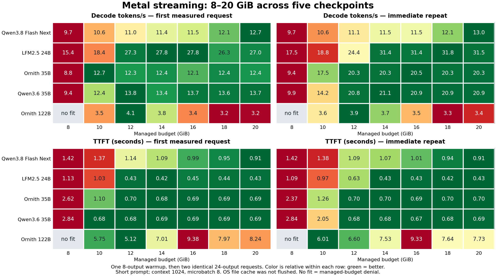

# Metal budget sweep: 8–20 GiB

Measured on 2026-11-15 on MTL0 / Apple M4 Max. The explicitly requested
scope was every available streaming architecture at 8, 10, 12, 14, 16,
18 and 20 GiB. Local GGUF metadata identifies three architectures across
five checkpoints: Qwen3.8 Flash Next (`qwen4exp`), LFM2.5-24B (`lfm2moe`),
and Ornith-35B, Qwen3.6-35B and Ornith-122B (`qwen35moe`). No local full
`qwen3moe` checkpoint was found. This is not coverage of all llama.cpp
architectures.

All 35 combinations were attempted. Thirty-four completed; Ornith-122B
at 8 GiB was rejected by managed-budget admission. A targeted descending
20/12 GiB pair then confirmed its nonmonotonic performance. No inference
source, default, replacement policy, or ordinary execution path was changed.

## Protocol and interpretation

Each point starts a fresh server with context 1024, batch 512, microbatch
8, one slot, eight CPU threads, 99 requested GPU layers and the indicated
managed budget. Automatic fitting, prompt caching, server warmup, prompt
cache RAM and context checkpoints are disabled. The same raw geography
prompt produces 33 input tokens on all five checkpoints. Sampling is
greedy with seed 42 and EOS ignored to keep output length fixed.

One 8-output request warms the server. Two 24-output requests are then
measured in that same slot, always with `cache_prompt: false`. The first
and second measurements represent different expert-cache states: they
are reported separately, not averaged as interchangeable repetitions.
TTFT is client time until the first nonempty emitted text token and
excludes process startup/model loading. Decode TPS is the server-reported
rate for the 23 steps after the first output token.

A temporary server probe records cumulative expert and macOS process
disk-read counters before prefill, after the first sampled output, and
after output 24. Deltas separate prefill and decode. Logical expert reads
include filesystem-cache hits; process-attributed disk reads are a separate
quantity. Phase timers are disabled. SHA-256 covers all 24 raw FP32 logit
rows; hashing takes 4.0–8.0 ms per request and is included in measured time.
The probe is outside the repository and production build.

Budgets ascend within each model, in the order shown above. All processes
run sequentially without overlapping builds or benchmark GPU workloads.
The OS file cache is not flushed or controlled, and the managed cap is
not a limit on the system-wide filesystem cache. Results therefore locate
performance boundaries for this workload and cache history, not universal
optimal budgets or long-context throughput.

## Findings

- **Qwen3.8:** repeat TPS rises across the grid:
  9.70, 10.55, 11.13, 11.50, 11.47, 12.10, 12.97.
  The tiny 14/16 GiB difference is not evidence of a meaningful regression.
  Repeat TTFT falls from 1.421 s at 8 GiB to 0.913 s at 20 GiB.
  Decode cache hits rise from 33.2% to 77.5%; logical decode reads fall
  from 12.926 to 4.407 GB. Physical decode reads are near zero in this
  sweep. The earlier 16 GiB measurements with substantial SSD traffic
  are not directly comparable to this filesystem-cache state. The working
  set still does not fit entirely in the expert cache at 20 GiB.
- **LFM2.5-24B:** the repeat-request plateau starts at 14 GiB, around
  31–32 TPS and 0.42–0.43 s TTFT. Repeat prefill and decode both reach
  100% expert-cache hits and zero logical reads. Actual managed use stops
  growing at about 12.741 GiB. At 12 GiB, the second request is worse than
  the first: decode hits fall from 94.8% to 90.2%, logical reads rise from
  1.058 to 2.013 GB, and TPS falls from 27.34 to 24.42. Both decode disk
  deltas are zero. This is a cache-content effect across requests, not
  proof that a warmer request must always be faster.
- **Ornith-35B:** the repeat plateau starts at 12 GiB: approximately
  20.3 TPS and 0.70 s TTFT, with 100% prefill/decode hits and no logical
  reads. Actual managed use is about 11.420 GiB regardless of larger caps.
  At 8 GiB, repeat decode is 9.36 TPS and still reads 1.068 GB from SSD.
- **Qwen3.6-35B:** 12 GiB similarly reaches the repeat plateau at about
  20.8–21.1 TPS and 0.67–0.69 s TTFT, using about 10.712 GiB. At 10 GiB,
  the first measured prefill hits 100%, but the next prefill hits only
  75.8% after the longer generation has changed cache contents. It rereads
  2.491 GB of experts, including 0.966 GB attributed to SSD, and TTFT rises
  from 0.680 to 2.049 s. Both phases are fully cached at 12 GiB on repeat.
- **Ornith-122B:** 8 GiB cannot admit the dense model allocations. The
  ledger denies a 5,838,602,240-byte reservation with 2,958,032,896 bytes
  already used against an 8,589,934,592-byte limit. This is a managed-cap
  rejection, not an unrestricted Metal allocation attempt. At successful
  budgets, the best decode point in the ascending grid is 12 GiB:
  3.90 repeat TPS, compared with 3.74/3.50/3.31/3.36 at 14/16/18/20 GiB.
  Repeat TTFT is 6.60 s at 12 GiB, peaks at 9.33 s at 16 GiB, and is
  7.73 s at 20 GiB. More expert residency does not improve this profile
  monotonically.

## Ornith-122B reverse confirmation

The 20/12 GiB confirmation uses identical settings and warmup. At 20 GiB,
first/repeat TPS is 3.32/3.36 and TTFT is 8.014/7.765 s. Returning to
12 GiB gives 3.95/3.86 TPS and 5.814/6.747 s TTFT. Thus the repeat
request is about 15% faster with the smaller cap in this reverse pair.

In the main sweep, 12 to 20 GiB improves decode hits from 41.0% to 63.3%
and reduces logical decode reads from 26.651 to 16.552 GB. Yet physical
decode reads rise from 8.528 to 14.088 GB. The reverse confirmation again
reduces physical reads from 14.117 GB at 20 GiB to 9.273 GB at 12 GiB.
Main-sweep process footprint at the end of repeat decode rises from about
11.15 to 19.25 GiB. These observations are consistent with competition
between explicit expert buffers and the OS file cache; they do not
independently identify the OS eviction policy or exclude other runtime
costs. The demonstrated result is the throughput reversal and additional
physical I/O, not a newly qualified cache-management fix.

## Validation and artifacts

All successful phase snapshots remain within their requested managed
caps. Within each model, output IDs and SHA-256 of all 24 full-vocabulary
logit rows match across every successful budget and both request positions,
including the reverse confirmation. This checks budget invariance; it is
not a fresh ordinary-versus-streaming qualification of every model.

The main scan contains 68 measured requests, plus four in the targeted
confirmation. No unit suite, ordinary-mode benchmark, MTP run, long-prefill
matrix, synthetic memory-pressure test or code optimization was performed
as part of this sweep.

[Raw results and model inventory](atomic-engine-metal-budget-sweep.json)
include exact timings, token IDs, logit digests, phase hit/miss/read counts,
ledger snapshots, process-memory snapshots, startup times, checkpoint shard
sizes, the diagnostic binary SHA-256, and the reverse confirmation.
